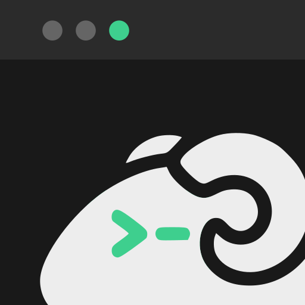

# herdr-web

<p align="center">
  
</p>

<p align="center">
  <a href="README.md">简体中文</a> · <b>English</b>
</p>

A terminal in your browser, built for running [`herdr`](https://github.com/zbysir/herdr).
One Go binary with the frontend baked in. Works on phones.

**Voice compose** is the point: dictate on a tablet, select the words that came out wrong and say
them again, then hand the whole paragraph to an agent's input line. A phone gets you by; a tablet
in landscape gives you 211 columns — that is a workstation.

```
┌─────────────────────────────────────────────┐
│  Panes  Files  Diff  Chat   ...   Settings  │  top bar: you pick the buttons
├─────────────────────────────────────────────┤
│                                             │
│    herdr's panes, exactly as on the desktop │
│                                             │
├─────────────────────────────────────────────┤
│  the paragraph you just said...  [  Send  ] │  outbox: one line, Enter sends
│  [kbd][^B][Ctrl][Esc][Arrows]...swipe...    │  shortcut bar: phones have no Ctrl
└─────────────────────────────────────────────┘
```

## Install

```bash
npm install -g @bysir/herdr-web    # easiest if you have node; upgrades come free
herdr-web                          # listens on 127.0.0.1 only
```

No node (common on servers):

```bash
curl -fsSL https://raw.githubusercontent.com/zbysir/herdr-web/master/install.sh | sh
```

Installs into `~/.local/bin` and **always verifies sha256** — there is a login shell behind this thing.

No native Windows build; install it inside WSL (the terminal needs a real PTY). `go install` works
too, but **what you get has no frontend** — the web assets are built by `make build` and are not in
the repo.

**Android app** (optional, beta): download `herdr-web_<version>.apk` from
[Releases](https://github.com/zbysir/herdr-web/releases), open it, enter the address of **your own**
herdr-web, then sign in with a pairing code or passkey. It is only a shell — install the server as
above. Upgrade by installing a newer APK over it.

→ From source, pinning a version, changing the install dir: [使用说明 · 装](docs/USAGE.zh-CN.md#装) (Chinese)

## Use

To reach it from a phone or tablet:

```bash
HERDR_WEB_HOST=0.0.0.0 herdr-web
```

The startup banner carries a **one-time pairing code** and its QR code; scan it and you are in.
**Pair once per device** — the credential lives in an HttpOnly cookie, so changing Wi-Fi, changing
subnets or rebooting costs you nothing. On connect it types `herdr` for you.

A path in the URL is **a different herdr session**: `/work` runs `herdr --session work`, so two
bookmarks are two separate working sets that survive closing the browser.

```bash
herdr-web pair          # another one-time pairing code + QR
herdr-web devices       # list paired devices
herdr-web revoke <id>   # kick one (all = everything); the next request gets 401
```

To use it from **a native terminal on another computer** instead of a browser:

```bash
herdr-web connect https://your.domain     # first time: approve with a passkey in a browser, or type a pairing code
```

That pairs an ordinary device (listed on the devices page, revocable) whose daily re-verification
is also a passkey approval in a browser; if the network stalls, type `~.` at the start of a line to disconnect.

→ Admin page, session naming rules, `connect`: [使用说明 · 第一次跑](docs/USAGE.zh-CN.md#第一次跑) (Chinese)

## What you get

| | |
|---|---|
| **Outbox** | The one-line input at the bottom: say a whole paragraph, send it to the agent's input line. Enter sends, `⇧↵` breaks a line; paste a screenshot with `⌘V`, or shoot a photo/video on the phone and get its path appended |
| **Shortcut bar** | Phones have no Ctrl key, and herdr is all `ctrl+b`. Keys are yours to define (key script, icon, popup group, pinned so they don't scroll away); arrow keys repeat when held |
| **Pane list** | One row per pane; tap one to jump there and go full screen. A red dot appears when an agent is waiting on you |
| **Chat** | Reads the agent's own session transcript into a conversation stream instead of that screenful of TUI — far easier to read on a phone |
| **Files** | The agent says "plot is at `/tmp/plot-3.png`" — tap the path and look at it. Images render, markdown renders as a document, text files can be edited in place |
| **Diff** | `git diff` is unreadable in a phone terminal: this wraps lines, highlights the changed words, and streams every file of one change continuously. **Read-only** |
| **Phones and tablets** | Touch gestures are fully taken over (drag = wheel reporting, long press = drag a pane border), the bottom dock can move to the right edge, portrait and landscape keep separate layouts |
| **Install as an app** | PWA: its own window, no address bar or toolbar — several free terminal rows |
| **Android app** (beta) | Same UI as the web page, plus what a web page can't do: **system notifications** when an agent finishes or waits for you, a status list in the notification shade and a home-screen widget; **automatic LAN direct connection** at home with the same address, falling back to the relay outside (top-left dot: green = direct, blue = relay); volume keys act as ↑ / ↓. The APK is on the [Releases](https://github.com/zbysir/herdr-web/releases) page |
| **Local ports** | A dev server an agent starts on `http://localhost:7830` opens at `https://7830.your-domain` after you log in; such links in the terminal and chat go there directly |

→ How each one works: [使用说明 · 能干什么](docs/USAGE.zh-CN.md#能干什么) (Chinese)

## Configure

**Environment variables are the only source of configuration** (no config file; the only flag is
`--web`). A few common setups:

```bash
herdr-web                                       # 1. purely local (default), plain http
HERDR_WEB_HOST=0.0.0.0 herdr-web                # 2. phone/tablet on the LAN: self-signed TLS + QR
HERDR_WEB_ONCONNECT= herdr-web                  # 3. stay in the shell, don't enter herdr

# 4. reachable from the internet: through the cloud relay (herdr-relay on a VPS forwards
#    ciphertext only; TLS terminates on this machine). Register once with
#    `herdr-web relay join https://relay.example.com mac.h.example.com <invite code>`
HERDR_WEB_RELAY_URL=https://relay.example.com HERDR_WEB_RELAY_HOST=mac.h.example.com \
HERDR_WEB_ACME_DNS=cloudflare HERDR_WEB_CLOUDFLARE_DNS_API_TOKEN=... herdr-web

# 5. On top of 4, proxy local ports: http://127.0.0.1:7830 → https://7830.mac.h.example.com
#    Add a *.mac.h.example.com wildcard DNS record; the certificate gains *.mac.h.example.com
HERDR_WEB_PORT_DOMAIN=mac.h.example.com
```

The main port (7788 by default) **only serves the local network**: a peer that is not loopback or
private gets a 403, and no switch opens it. The internet only comes in through the relay — the VPS
sees ciphertext only, so a compromised VPS cannot read your terminal. The frp / TLS-terminating
reverse-proxy path (`PUBLIC_PORT`, `TLS=proxy`) was retired on 2026-10-23; see [DEPLOY.md](DEPLOY.md).

→ The full table of 40-odd variables: [使用说明 · 配置](docs/USAGE.zh-CN.md#配置) (Chinese)

## Daemon · Updating

```bash
herdr-web service install    # macOS → launchd; Linux → systemd user unit, starts at login
herdr-web update             # check + upgrade, by however it was installed
```

Configuration is snapshotted from the current shell at `install` time, so changing it means running
`install` again with a different environment (it is idempotent).

→ [Daemon](docs/USAGE.zh-CN.md#守护进程) · [Updating](docs/USAGE.zh-CN.md#更新) (Chinese)

## Security

This is effectively a shell over HTTP, and the door is built on that assumption:

- **Pair once per device**: a one-time code buys a per-device credential; the server stores **only a sha256**;
- **Credentials bind to the device, not the IP**, so changing networks never logs you out; **no secrets in URLs** (`?pair=` becomes a cookie and is 302'd away);
- **Only someone sitting at the machine can mint a pairing code** — no path in the web UI produces one; that is the single out-of-band factor;
- **Exposed without TLS refuses to start**; a Host allow-list stops DNS rebinding, three mechanisms stop CSRF, code guessing gets exponential backoff plus lockout;
- **Passkeys are a second factor**; the server stores only public keys;
- **The internet only comes in through your own relay, which forwards ciphertext only**: TLS terminates on
  your machine, the VPS holds no certificate key, device table or passkey, and a DNS CAA record pins
  "only this machine can get a certificate" — a fully compromised relay can only cut you off;
- **Local ports live on their own subdomains**: the proxied page is the agent's, so it never sees the main
  site's credentials; you must log in first, and revoking a device takes effect immediately.

→ Threat model and the reasoning behind each line: [SECURITY.md](docs/dev/SECURITY.md) (Chinese)

## Documents

| What you want | Where |
|---|---|
| Installing, using, every configuration option | [docs/USAGE.zh-CN.md](docs/USAGE.zh-CN.md) |
| Where to run it, public access, the four TLS tiers | [DEPLOY.md](DEPLOY.md) |
| Getting a DNS token from each provider | [DNS.md](DNS.md) |
| **Why it is built this way**, hand-verified semantics, traps that fail silently | [docs/dev/](docs/dev/README.md) |
| Read before changing code (layout, releases, palette) | [CLAUDE.md](CLAUDE.md) |

**Those documents are in Chinese** — they are the real substance of this project, and this page is
the only English one.

MIT.
